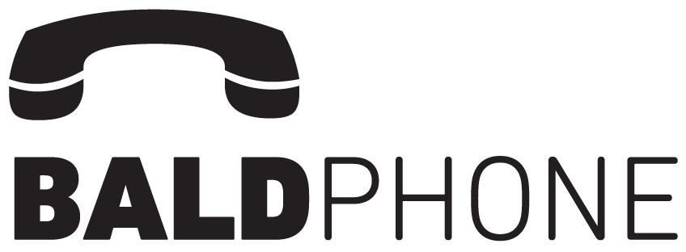
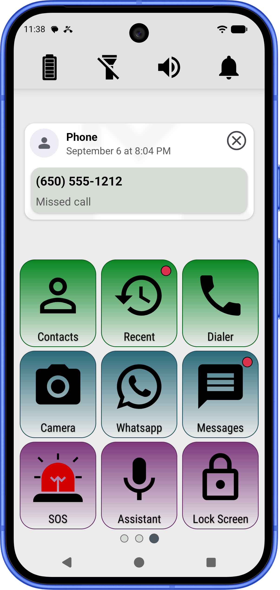
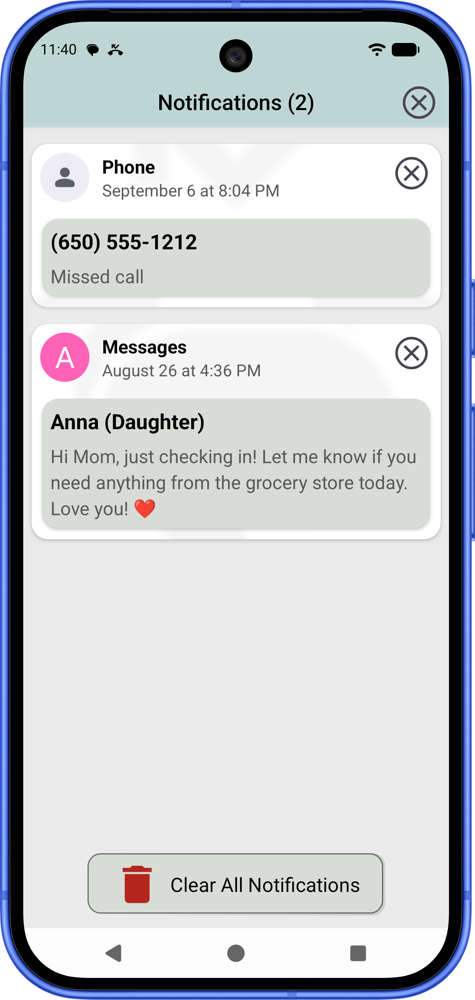
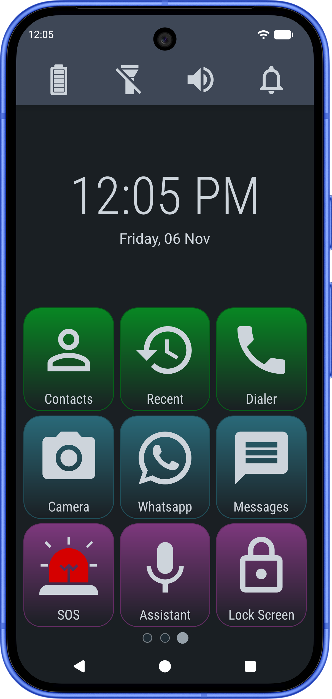

# BaldPhone Neo

*The next generation of BaldPhone.*

## Overview

**BaldPhone Neo** is the modernized continuation of the original [BaldPhone](https://github.com/UriahShaulMandel/BaldPhone) project created by Uriah Shaul Mandel.

Its mission remains unchanged: making smartphones accessible and intuitive for seniors, individuals with disabilities, caregivers, and anyone who prefers a simplified mobile experience.

While preserving the core vision, BaldPhone Neo introduces a refined interface, optimized performance, enhanced notification management, and ongoing codebase migration to Kotlin.

## Key Features

- Large, easy-to-read interface
- Simplified navigation and interaction
- Accessibility-focused design
- Better notification management
- Quick Lock
- Optimized performance and lower resource usage
- Android 15+ support
- Ongoing UX and accessibility improvements

## Screenshots

    
    
    

More screenshots

## Download

- **[Download the latest APK](https://github.com/DamianKuzmiak/BaldPhone/releases/latest)**
- **F-Droid:** planned

## Direct APK Installation

1. Download the latest `.apk` file from the [Releases](https://github.com/DamianKuzmiak/BaldPhoneNeo/releases/latest) section.
2. Enable installation from unknown sources in your device settings if prompted.
3. Open the downloaded file and follow the system prompts.

> [!WARNING]
> Installing APK files outside Google Play Store could require additional advanced steps starting in 2027.
> For information regarding open app distribution standards, visit [KeepAndroidOpen](https://keepandroidopen.org/).

> [!NOTE]
> **Google Play Availability:** BaldPhone Neo is not distributed via Google Play due to strict policy limitations regarding core accessibility and system-level permissions required for its comprehensive functionality.

## Get Involved

You can support the project by:
- Translating or improving existing translations (see: [TRANSLATING](TRANSLATING.md))
- Testing and reporting issues
- Sharing the project with accessibility communities
- Suggesting improvements to the user experience

## Contact

For questions, suggestions, or feedback: neo.baldphone@gmail.com

## License

BaldPhone Neo is distributed under the **Apache License 2.0**. See the [LICENSE](LICENSE) file for details.
